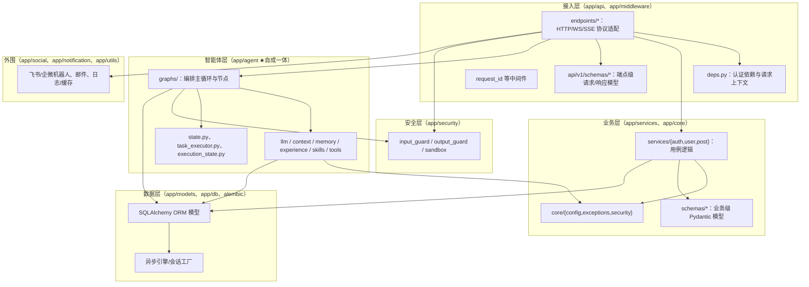

# 模块边界与依赖规则（LangGraph 后端）

> 目的：说清"谁负责什么、谁可以依赖谁、什么绝不允许"。
> 配套：整体架构 [overview.md](overview.md)｜编码规范 [../conventions/README.md](../conventions/README.md)。

## 1. 分层总图与依赖方向

**铁律：依赖只能向下（图中箭头方向），禁止反向与跨层乱跳。**

## 2. 各模块职责边界

### 2.1 接入层 `app/api/`

| 模块 | 负责 | 不负责 |
|---|---|---|
| `v1/endpoints/*` | 路径/方法/参数解析、调用依赖注入、组装响应、SSE 事件桥 | 业务算法、SQL 细节、LLM 调用 |
| `deps.py` | JWT 解析 → 当前用户 dict；DB 会话依赖 | 业务校验（如资源归属判断应在 endpoint/service） |
| `v1/schemas/*` | 端点级请求/响应 Pydantic 模型 | 业务规则 |
| `app/middleware/*` | 请求 ID、耗时、开发日志 | 认证（AuthMiddleware 未注册，勿依赖） |

**边界规则**：
- endpoint 只做"协议编排"：`guard 检查 → 调 service/graph → 组响应`；
- `endpoints/agent.py` 是例外的"厚端点"（SSE 桥、会话落库、历史拼装都在此），
  改动时优先把新逻辑下沉到 `app/agent/`，不要再往这个文件里堆；
- 认证三件套：`CurrentUser`（必登录）/ `OptionalCurrentUser`（可空）/ `CurrentAdminUser`（管理员）。

### 2.2 业务层 `app/services/` + `app/core/`

| 模块 | 负责 | 不负责 |
|---|---|---|
| `services/auth.py` | 注册/登录/刷新令牌用例，抛认证类异常 | HTTP 协议细节 |
| `services/user.py` | 用户资料/密码/管理员操作 | 角色以外的权限策略 |
| `services/post.py` | 文章 CRUD/发布/归档与归属校验 | 序列化格式 |
| `core/config.py` | 全部静态配置与派生方法 | 运行时可变状态 |
| `core/exceptions.py` | 异常类型定义 | 处理逻辑（handler 在 main.py） |
| `core/security.py` | JWT 签发/校验、密码哈希 | 用户查找（属 services） |

**边界规则**：services 抛 `AppException` 子类，不返回错误码字符串、不碰 `HTTPException` 以外的协议对象。

### 2.3 智能体层 `app/agent/`（核心，自成一体）

按能力域再分子包，每个子包用 `__init__.py` 导出公共 API：

| 子包 | 职责 | 边界要点 |
|---|---|---|
| `graphs/` | 编排：`AgentGraph.execute()` 主循环、节点、监督/安全/动态子图 | **唯一编排决策点**；不直接发 HTTP/SSE，只调 `on_step` 回调 |
| `graphs/nodes/` | 意图/规划/执行/重规划/整合/守卫 单节点逻辑 | 节点间不互相 import，只通过状态对象与主循环衔接 |
| `llm/` | 工厂、多 Provider 路由（cost/quality/balance）、预算计费 | 不感知 HTTP；不直接写库 |
| `context/` | ContextManager：按需加载/掩码/压缩/召回 | **失败只降级不阻塞**（三钩子全 try/except）；全量压缩只在 turn 结束钩子 |
| `memory/` + `experience/` | 短/长期记忆、Postgres checkpoint、经验库 | 持久化协议统一走 saver/retriever 接口 |
| `skills/` | 10 个技能，`skill.py + SKILL.md` 渐进加载 | 技能不得绕过 tools/安全检查直接执行任意代码 |
| `tools/` | storage/social/notification 外部工具 | 只做 IO 封装，不含编排决策 |
| `state.py` / `execution_state.py` | ExecutionContext、Todo/执行状态、LoopDetector | 纯状态与规则，无 IO |
| `task_executor.py` | `task_manager` 任务注册与状态 | 不执行任务本体 |
| `cancel_signal.py` / `roundcap_judge.py` | 取消位、30 轮上限裁判 | 横切能力，被主循环轮询 |

**边界规则**：
- `app/agent/**` 不 import `app/api/**`（禁止反向依赖接入层）；
- 上下文/记忆等非关键路径失败必须降级，绝不让任务崩掉；
- 技能执行文件操作必须在任务目录内（路径锚定规则见 `skills/file_operations/SKILL.md`）。

### 2.4 安全层 `app/security/`

| 模块 | 职责 |
|---|---|
| `input_guard` | 入口处对用户 task 做安全检查（端点第一行调用） |
| `output_guard` | 最终回答敏感信息检查与掩码（非流式路径调用） |
| `sandbox` | 代码执行的 Docker 沙箱封装 |

**边界规则**：安全检查是端点的**前置义务**（`execute/` 与 `execute/stream` 均先
`input_guard.check`），任何新执行入口都必须先过守卫；安全层不依赖业务层。

### 2.5 数据层 `app/models/` + `app/db/` + `alembic/`

| 模块 | 职责 |
|---|---|
| `models/*` | SQLAlchemy ORM 表映射（user/post/session/task/experience…） |
| `db/base.py` | `DeclarativeBase` + `IDMixin`/`TimestampMixin`/`SoftDeleteMixin` |
| `db/session.py` | 异步引擎、`AsyncSessionLocal`、`get_db`、`init_db`/`close_db` |
| `alembic/versions/` | 迁移文件，手写编号 `00N_描述`（非 hash） |

**边界规则**：
- models 不含业务逻辑；SQL 拼装在 services 或明确的查询函数中；
- 新增表/字段**必须**补 Alembic 迁移（当前至 `009_add_user_deepseek_api_key`）；
- 只读查询后显式 `rollback()` 归还连接，防 idle-in-transaction 耗尽连接池
  （`endpoints/agent.py` 的 `_load_hist_note` 是范例）。

### 2.6 外围 `app/social/`、`app/notification/`、`app/utils/`

- social：飞书/企微等渠道发送实现；notification：邮件等通道；
  两者只被对应 endpoints 调用，互相不依赖；
- `utils/logger.py`、`utils/cache.py`：横切工具，任何层可用，但不得反向 import 业务模块。

## 3. 依赖规则清单（可执行的"允许/禁止"）

| # | 规则 |
|---|---|
| R1 | 方向：`api → services/agent → security → core`，`models/db` 被上层依赖，**禁止反向** |
| R2 | `app/agent/**` 禁止 import `app/api/**`、`app/services/**` 的 HTTP 相关对象 |
| R3 | `app/security/**` 禁止 import `app/api/**`、`app/agent/**` |
| R4 | endpoints 不直接写裸 SQL；跨表事务在 service 或独立函数中收口 |
| R5 | 新接口必须同时更新：`endpoints` + `schemas` + `docs/reference/api-spec.yaml` |
| R6 | 新表/字段必须补 `alembic/versions/00N_*.py` |
| R7 | 新错误必须用 `AppException` 子类并分配 `error_code`（见 error-codes.md） |
| R8 | Agent 非关键路径（上下文、记忆、历史拼装、落库兜底）失败只降级不阻塞 |
| R9 | 终态事件与落库顺序：**先落库、再推 `complete/error/stopped`** |
| R10 | 图内对外状态变化只能经 `on_step` 回调，禁止节点内直接构造 SSE 字符串 |

## 4. 已知边界瑕疵（改造时注意）

| 问题 | 位置 | 现状/方向 |
|---|---|---|
| 两套路由组织并存 | `app/api/v1/router.py` 聚合路由 vs `main.py` 逐个挂载 | 实际生效的是 main.py 写法；`router.py`/`__init__.py` 聚合路由是死代码，勿引用 |
| AuthMiddleware 未注册 | `app/api/middleware/auth.py` | 认证只走 deps，勿假设全局中间件在鉴权 |
| 厚端点 | `endpoints/agent.py`（1100+ 行） | 新逻辑优先下沉 `app/agent/` |
| 双风格异常 | endpoints 中 ~20 处裸 `HTTPException` | 逐步迁移到 `AppException` 子类 |
| 配置漂移 | 根 `requirements.txt`（Flask 残留）与 `Dockerfile` | 依赖以 `pyproject.toml` 为准，详见 overview.md §7 |
| 会话双轨 | `endpoints/agent.py` 的会话存储 与 `endpoints/session.py` 纯内存会话 | 前端 agent 域用前者（落库）；session router 是历史遗留，勿混用 |
