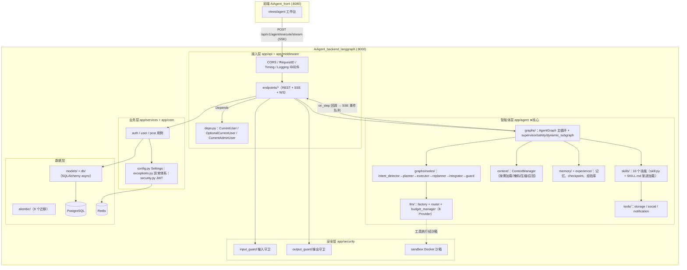
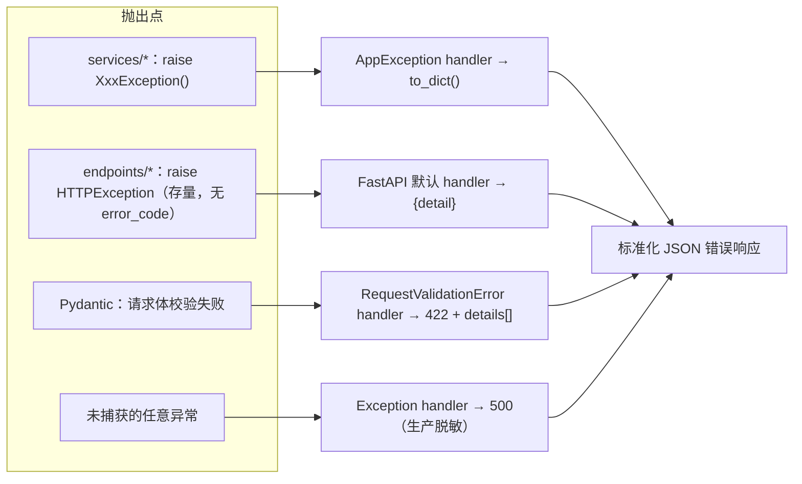
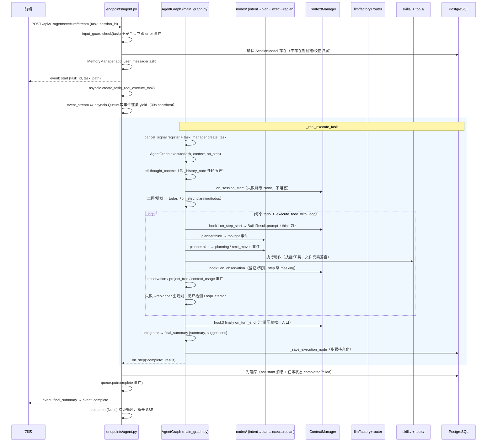

# 系统架构总览（LangGraph 后端）

> 适用范围：`AiAgent_backend_langgraph`（:8000）。姊妹后端 `AiAgent_backend_autogen`（:8001）
> 不在本文范围；两者共享前端协议，见仓库根 `CLAUDE.md`。
> 关联文档：模块边界 [boundaries.md](boundaries.md)｜错误码 [../reference/error-codes.md](../reference/error-codes.md)｜
> API 规范 [../reference/api-spec.yaml](../reference/api-spec.yaml)｜上下文管理速查 `README_CONTEXT.md`。

## 1. 项目定位与技术栈

RiffCode 智能体后端：接收自然语言任务 → 意图识别 → 规划/执行/重规划循环 → 通过技能（Skill）
真实读写文件、调用工具 → SSE 流式回传过程与结果。附带用户、文章、存储、社交、通知等常规业务。

| 层 | 选型 | 备注 |
|---|---|---|
| Web 框架 | **FastAPI** + uvicorn | 非 Flask；见 §7 已知配置漂移 |
| 数据库 | PostgreSQL + SQLAlchemy 2.0（asyncpg）+ Alembic + Redis | 异步会话，迁移 00N_ 手写编号 |
| AI 编排 | LangGraph + LangChain；DeepSeek/Kimi/智谱/OpenAI/Anthropic/Gemini/MiniMax/Ollama | 多 Provider 路由与预算控制 |
| 配置 | pydantic-settings + `.env` | `get_settings()` 单例 |
| 可观测 | loguru 文本日志 + execution_nodes 落库 + SSE 事件流 | ⚠️ OpenTelemetry/Langfuse 仅在 pyproject 声明依赖，**代码零接入**（详见调研结论） |
| 测试/质量 | pytest（asyncio auto）、ruff（line-length 100）、mypy | 黄金门禁 `run_golden.py` |

## 2. 整体架构图



## 3. 应用启动层

启动链自上而下：

```
python run.py
  └─ uvicorn.run("app.main:app", host=0.0.0.0, port=8000, reload=True)
       └─ app/main.py 模块级 app = create_app()
```

### 3.1 `create_app()` 装配顺序（`app/main.py:73`）

1. `setup_logger()`：按 Settings 初始化 loguru（级别 + 文件）；
2. 构造 `FastAPI(...)` 实例，挂 `lifespan`；
3. **中间件**（后加的先执行）：`CORSMiddleware` → `RequestIDMiddleware` → `RequestTimingMiddleware`
   → 开发环境额外 `RequestLoggingMiddleware`；
4. **逐个挂载路由**（实际生效的唯一方式）：11 个 router 全部带 `/api/v1/*` 前缀，
   见 `app/main.py:108-118`；另注册根级 `GET /`、`GET /health`；
5. **注册 3 个全局异常处理器**：`AppException` / `RequestValidationError` / `Exception`（见 §5）。

> 注意：`app/api/v1/router.py` 的聚合 `api_router` 与 `app/api/v1/__init__.py` 的
> `api_v1_router` **均未被 include，属死代码**；`app/api/middleware/auth.py` 的
> `AuthMiddleware` 也未注册——认证完全靠 `deps.py` 依赖注入。

### 3.2 `lifespan` 生命周期（`app/main.py:40`）

```
启动：get_settings() → init_db()（失败仅记日志，不阻断）
     → bootstrap_skills()（Skill 渐进加载器引导，失败仅记日志）
     → yield（服务期）
关闭：close_db()
```

设计原则：**启动期非关键路径失败只降级不阻塞**（与 Agent 运行期铁律一致）。

## 4. 框架核心层

| 组件 | 位置 | 职责 |
|---|---|---|
| 配置单例 | `app/core/config.py` | `Settings(BaseSettings)` 读 `.env`；`get_settings()` 用 `lru_cache` 单例；`build_context_config()` 等派生方法 |
| 依赖注入 | `app/api/deps.py` | `CurrentUser`（强制登录）/ `OptionalCurrentUser`（可选）/ `CurrentAdminUser`（要求 role=admin）；返回 `{"id","username","role"}` |
| 请求标识 | `app/middleware/request_id.py` | 请求 ID 注入、耗时统计、开发期请求日志 |
| 业务异常 | `app/core/exceptions.py` | `AppException` 及子类（见 §5） |
| JWT | `app/core/security.py` | 令牌签发/校验、密码哈希；声明 `exp/sub/type/iat` |
| 任务注册 | `app/agent/task_executor.py` | `task_manager`：任务运行状态查询与中断标记 |
| 取消信号 | `app/agent/cancel_signal.py` | 按 session 注册/检查取消位，图内循环轮询 |

**认证方式**：`Authorization: Bearer <access_token>`；token 由
`POST /api/v1/auth/login` 返回（`access_token` / `refresh_token` / `expires_in`）。
依赖使用 `HTTPBearer(auto_error=False)`，401 由 deps 自行抛出并带 `WWW-Authenticate: Bearer`。

## 5. 异常体系

### 5.1 类结构

全部业务异常继承 `AppException(HTTPException)`（`app/core/exceptions.py`），
携带 `error_code`（前端区分错误类型）与 `extra`（结构化附加数据），`to_dict()` 统一序列化：

```python
{"error": detail, "status_code": int, "error_code"?: str, "extra"?: dict}
```

```
HTTPException (FastAPI)
└── AppException                      # 基类：status_code + detail + error_code + extra
    ├── UnauthorizedException         # 401 UNAUTHORIZED
    │   ├── InvalidCredentialsException   # 401 INVALID_CREDENTIALS
    │   ├── TokenExpiredException         # 401 TOKEN_EXPIRED
    │   └── InvalidTokenException         # 401 INVALID_TOKEN
    ├── ForbiddenException            # 403 FORBIDDEN
    │   ├── InsufficientPermissionsException  # 403 INSUFFICIENT_PERMISSIONS
    │   ├── UserInactiveException           # 403 USER_INACTIVE
    │   └── UserBannedException             # 403 USER_BANNED
    ├── NotFoundException             # 404 NOT_FOUND（extra: resource/resource_id）
    ├── AlreadyExistsException        # 409 ALREADY_EXISTS
    │   ├── EmailAlreadyExistsException    # EMAIL_ALREADY_EXISTS
    │   └── UsernameAlreadyExistsException # USERNAME_ALREADY_EXISTS
    ├── BadRequestException           # 400 BAD_REQUEST
    ├── ValidationException           # 422 VALIDATION_ERROR
    ├── InternalServerException       # 500 INTERNAL_ERROR
    └── ServiceUnavailableException   # 503 SERVICE_UNAVAILABLE（extra: retry_after）
```

### 5.2 三个全局处理器（`app/main.py:134-173`）

| 处理器 | 触发 | 响应形态 |
|---|---|---|
| `AppException` handler | 业务异常 | `exc.to_dict()` 原样输出，状态码取 `exc.status_code` |
| `RequestValidationError` handler | Pydantic 参数校验失败 | 422 `{error, error_code:"VALIDATION_ERROR", details:[{field,message,type}]}` |
| `Exception` handler（兜底） | 未捕获异常 | 500；生产环境隐藏细节，开发环境附 `str(exc)` + 类型名 |

### 5.3 异常流转图



**规范与现状**：新代码应抛 `AppException` 子类；但 endpoints 层仍有 ~20 处直接
`raise HTTPException`（仅 `detail`，无 `error_code`），两种风格并存——完整清单见
[../reference/error-codes.md](../reference/error-codes.md)。

**Agent 流特殊性**：`/execute/stream` 是 SSE 流，异常不走 HTTP 状态码，而是转成
`event: error / stopped` 事件（见 §6.4）；`AgentGraph.execute()` 内部吞异常并返回
`success=False` 的结果 dict，由端点侧决定落库 `failed` 与推送 `complete`。

## 6. Agent 请求 → 输出处理流程

### 6.1 时序图（SSE 主链路）



**关键顺序约定（踩坑沉淀）**：**先落库、再推终态事件**——前端收到 `complete`
会立即断开，后置 await 会被 `CancelledError` 打断（2026-11-10/14 两次生产实测）。
`_persist_assistant` 用独立协程 + 独立 DB 会话，避免依赖请求作用域资源。

### 6.2 图内执行模型（`main_graph.py`）

`AgentGraph` 并非 `StateGraph` 的声明式 DAG，而是**类内命令式主循环**
（`graphs/` 下 `supervisor_graph.py` / `safety_graph.py` / `dynamic_subgraph.py`
提供监督决策、安全图与动态子图能力）：

```
AgentGraph.execute()                      # 一次 turn = 一个用户请求
 ├─ 断点恢复判断（resumed 事件）
 ├─ _execute_unified()                    # 按 todos 顺序推进
 │    └─ _execute_todo_with_loop()        # 单 todo 的 step 循环
 │         while 未完成:
 │           hook1 → think(planner) → plan → next_moves
 │           → 执行动作（技能/工具）→ hook2 observation
 │           → 失败则 replanner；LoopDetector 防原地自旋
 │           → 30 轮上限 roundcap_judge 判"继续/终止"
 └─ integrator → final_summary → complete
```

- **step**：`_execute_todo_with_loop()` 内一次 think→plan→execute→observe；
- **turn**：`execute()` 一次调用；ContextManager 在此新建、`finally` 中 `on_turn_end`；
- **on_step 回调**：图内一切对外可见状态都经 `on_step(step_type, data)` 发出，
  端点侧翻译成 SSE 事件（16 种，清单见 api-spec.yaml）。

### 6.3 端点侧事件桥（`endpoints/agent.py`）

```
on_step(step_type, data)
  ├─ final_summary → 立即 _schedule_persist（独立协程落库 assistant）
  ├─ complete      → 兜底落库（final_summary 缺失场景，共用去重开关）
  └─ 其余          → asyncio.Queue.put("event: {step_type}\ndata: {json}\n\n")

event_stream() 循环：queue 取事件 yield；30s 无事件发 heartbeat；
  任务终态 → 先 _finalize_db_task 落库 → 再推 complete/error/stopped → queue.put(None)
前端断连（CancelledError）→ 若已有 final_summary 文本仍落库；task.cancel() + graph.cancel()
```

### 6.4 终态语义

| 事件 | 含义 | 数据库任务状态 |
|---|---|---|
| `complete` | 正常结束（结果在 `result`，总结在 `final_summary` 事件） | `completed`（`success=False` 时为 `failed`） |
| `error` | 执行异常 / 输入守卫拒绝 | `failed` |
| `stopped` | 用户 abort / 前端断连中断 | `failed`（"任务被取消"） |
| `heartbeat` | 30s 保活 | — |

## 7. 已知配置漂移（重要）

**系统是 FastAPI，不是 Flask。** 但根目录 `requirements.txt` 残留旧 Flask 栈：

```
Flask==2.3.3 / Flask-SQLAlchemy==3.0.5 / Flask-Login==0.6.2 ...
```

- 真实依赖以 **`pyproject.toml`** 为准（fastapi / langgraph / sqlalchemy[asyncio]…）；
- 本地开发用 `.venv` + `pyproject.toml`，一切正常；
- **`Dockerfile` 却 `pip install -r requirements.txt`** → 按现 Dockerfile 构建的镜像
  装的是 Flask 栈、缺少 FastAPI/LangGraph，无法运行 `uvicorn app.main:app`。
  修复方向：Dockerfile 改为 `pip install .`（或 `uv sync`），并清理过时 requirements.txt。

## 8. 关键文件索引

| 关注点 | 文件 |
|---|---|
| 启动与装配 | `run.py`、`app/main.py` |
| 配置 | `app/core/config.py`、根 `config.py`（gitignore）、`.env` |
| 异常体系 | `app/core/exceptions.py` |
| 认证依赖 | `app/api/deps.py`、`app/core/security.py` |
| Agent 执行入口 | `app/api/v1/endpoints/agent.py` |
| 图主循环 | `app/agent/graphs/main_graph.py`（AgentGraph） |
| 图节点 | `app/agent/graphs/nodes/{intent_detector,planner,executor,replanner,integrator,guard}.py` |
| 上下文管理 | `app/agent/context/`、`README_CONTEXT.md`、根 `CONTEXT_MANAGER_PLAN.md` |
| LLM 路由 | `app/agent/llm/{factory,router,budget_manager}.py` |
| 黄金门禁 | `run_golden.py`、`tests/GOLDEN.md`、`tests/TESTCASES.md` |
